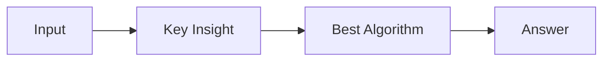

# LC 1521. Find a Value of a Mysterious Function Closest to Target

> Hard · [LeetCode](https://leetcode.com/problems/find-a-value-of-a-mysterious-function-closest-to-target/) · Tags: Array, Binary Search, Bit Manipulation, Segment Tree, Sparse Table

## 题意

（待补：一句话题意）

## 最优思路

（待补：最优解核心 intuition）

## 图解

## 复杂度

| 项 | 值 |
|----|----|
| 时间 | TBD |
| 空间 | TBD |

## 代码

见同目录 `1521.find-a-value-of-a-mysterious-function-closest-to-target.py`。

## 参考

- https://leetcode.com/problems/find-a-value-of-a-mysterious-function-closest-to-target/
