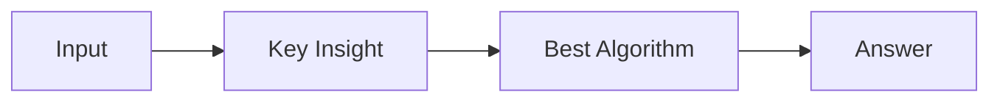

# LC 1595. Minimum Cost to Connect Two Groups of Points

> Hard · [LeetCode](https://leetcode.com/problems/minimum-cost-to-connect-two-groups-of-points/) · Tags: Array, Dynamic Programming, Bit Manipulation, Matrix, Bitmask, Bipartite Graph, Successive Shortest Path Algorithm, Matching (Graph), Minimum-Cost Flow, Flow Network

## 题意

（待补：一句话题意）

## 最优思路

（待补：最优解核心 intuition）

## 图解

## 复杂度

| 项 | 值 |
|----|----|
| 时间 | TBD |
| 空间 | TBD |

## 代码

见同目录 `1595.minimum-cost-to-connect-two-groups-of-points.py`。

## 参考

- https://leetcode.com/problems/minimum-cost-to-connect-two-groups-of-points/
