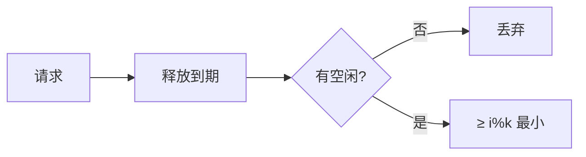

# LC 1606. Find Servers That Handled Most Number of Requests

> Hard · [LeetCode](https://leetcode.com/problems/find-servers-that-handled-most-number-of-requests/) · Tags: Array, Heap, Simulation, Ordered Set

## 题意

`k` 台服务器。第 `i` 请求在 `arrival[i]` 到达、耗时 `load[i]`。优先空闲且编号 `≥ i%k` 的最小服务器，否则绕回；全忙则丢弃。返回处理数最多的服务器。

## 最优思路

忙碌最小堆 + 空闲有序表：`bisect_left(i%k)` 取目标。

## 图解

## 复杂度

| 项 | 值 |
|----|----|
| 时间 | \(O(n\log k)\) |
| 空间 | \(O(k)\) |

## 代码

见 `1606.find-servers-that-handled-most-number-of-requests.py`。
