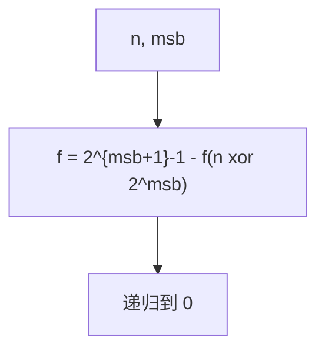

# LC 1611. Minimum One Bit Operations to Make Integers Zero

> Hard · [LeetCode](https://leetcode.com/problems/minimum-one-bit-operations-to-make-integers-zero/) · Tags: Dynamic Programming, Bit Manipulation, Memoization

## 题意

两种操作：翻转最低位，或翻转「最低 1 位左边一位」。求把 `n` 变成 `0` 的最少操作数。

## 最优思路

操作序列对应 Gray 码：`f(n)=2^{msb+1}-1-f(n⊕2^{msb})`。把最高位置 1 再归零的代价是 `2^{msb+1}-1`，中间对称减掉对称部分。

## 图解

## 复杂度

| 项 | 值 |
|----|----|
| 时间 | \(O(\log n)\) |
| 空间 | \(O(\log n)\) |

## 代码

见 `1611.minimum-one-bit-operations-to-make-integers-zero.py`。
