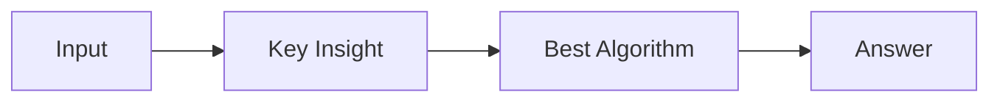

# LC 1617. Count Subtrees With Max Distance Between Cities

> Hard · [LeetCode](https://leetcode.com/problems/count-subtrees-with-max-distance-between-cities/) · Tags: Dynamic Programming, Bit Manipulation, Tree, Enumeration, Bitmask

## 题意

（待补：一句话题意）

## 最优思路

（待补：最优解核心 intuition）

## 图解

## 复杂度

| 项 | 值 |
|----|----|
| 时间 | TBD |
| 空间 | TBD |

## 代码

见同目录 `1617.count-subtrees-with-max-distance-between-cities.py`。

## 参考

- https://leetcode.com/problems/count-subtrees-with-max-distance-between-cities/
