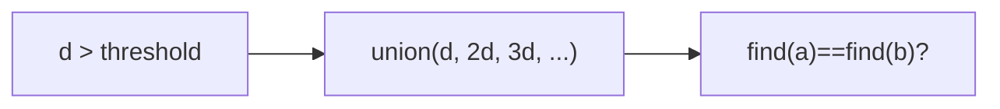

# LC 1627. Graph Connectivity With Threshold

> Hard · [LeetCode](https://leetcode.com/problems/graph-connectivity-with-threshold/) · Tags: Array, Math, Union Find, Number Theory

## 题意

城市 `1..n`，若 `gcd(a,b)>threshold` 则边相连。对若干查询返回两点是否连通。

## 最优思路

对每个 `d>threshold`，把 `d,2d,3d,...` 用并查集连起来（共享因子 `d` 即边）。查询看是否同根。

## 图解

## 复杂度

| 项 | 值 |
|----|----|
| 时间 | \(O(n\log n + q\,\alpha(n))\) |
| 空间 | \(O(n)\) |

## 代码

见 `1627.graph-connectivity-with-threshold.py`。
