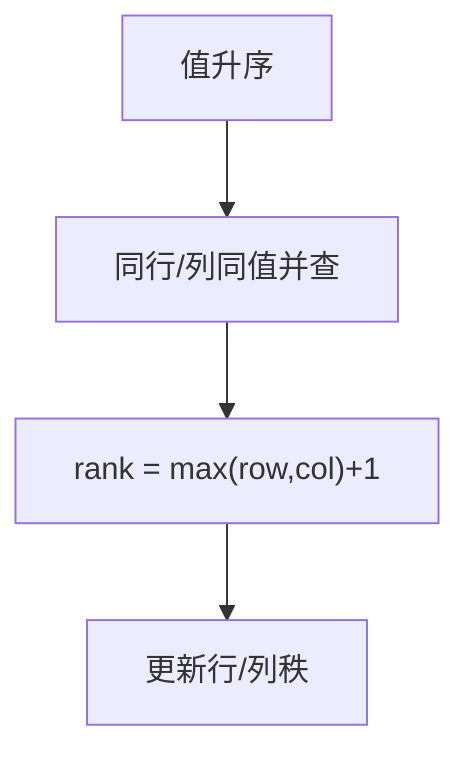

# LC 1632. Rank Transform of a Matrix

> Hard · [LeetCode](https://leetcode.com/problems/rank-transform-of-a-matrix/) · Tags: Union-Find, Sorting, Matrix

## 题意

把矩阵每个元素替换为秩：同行/同列中严格更小值的秩必须更小；相等值同秩；秩尽量小的正整数。

## 最优思路

按值从小到大处理。同值格子若共享行/列需同秩：用并查集把「行节点 + 列节点」连通。新秩 = 组内 `max(行已用秩, 列已用秩)+1`，写回并更新行/列秩。

## 图解

## 复杂度

| 项 | 值 |
|----|----|
| 时间 | \(O(mn\log(mn)\alpha)\) |
| 空间 | \(O(mn)\) |

## 代码

见 `1632.rank-transform-of-a-matrix.py`。
