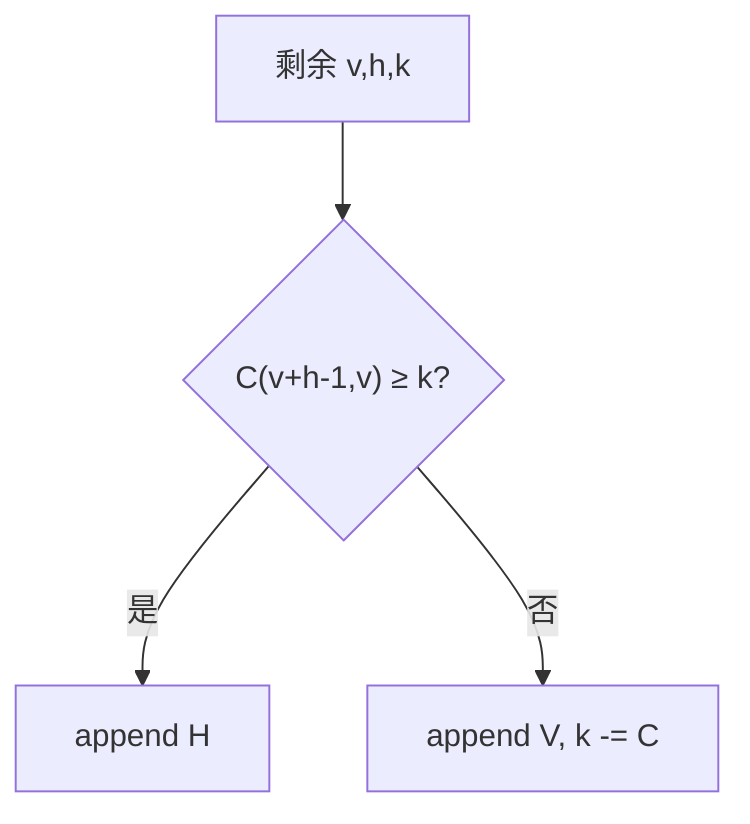

# LC 1643. Kth Smallest Instructions

> Hard · [LeetCode](https://leetcode.com/problems/kth-smallest-instructions/) · Tags: Array, Math, String, Combinatorics, DP

## 题意

从 `(0,0)` 到 `(row,col)` 只能向右 `H`、向下 `V`，字典序第 `k` 小的路径字符串。

## 最优思路

逐步决策：若先走 `H`，剩余路径数 `C(rem_v+rem_h-1, rem_v)`；若 `≥k` 则选 `H`，否则选 `V` 且 `k` 减去该数。

## 图解

## 复杂度

| 项 | 值 |
|----|----|
| 时间 | \(O((v+h)\cdot\log)\)（`comb`） |
| 空间 | \(O(v+h)\) |

## 代码

见 `1643.kth-smallest-instructions.py`。
