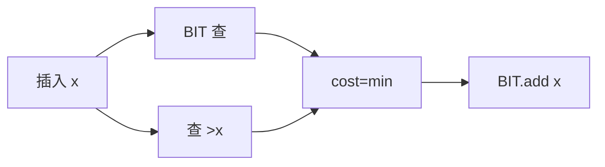

# LC 1649. Create Sorted Array through Instructions

> Hard · [LeetCode](https://leetcode.com/problems/create-sorted-array-through-instructions/) · Tags: Binary Indexed Tree, Segment Tree

## 题意

依次把 `instructions[i]` 插入有序数组，代价为 `min(严格更小数个数, 严格更大数个数)`。返回总代价 mod \(10^9+7\)。

## 最优思路

树状数组维护已插入值的频次：`sum(x-1)` 为更小个数，`i - sum(x)` 为更大个数。每次取 min 累加后插入。

## 图解

## 复杂度

| 项 | 值 |
|----|----|
| 时间 | \(O(n\log M)\) |
| 空间 | \(O(M)\) |

## 代码

见 `1649.create-sorted-array-through-instructions.py`。
