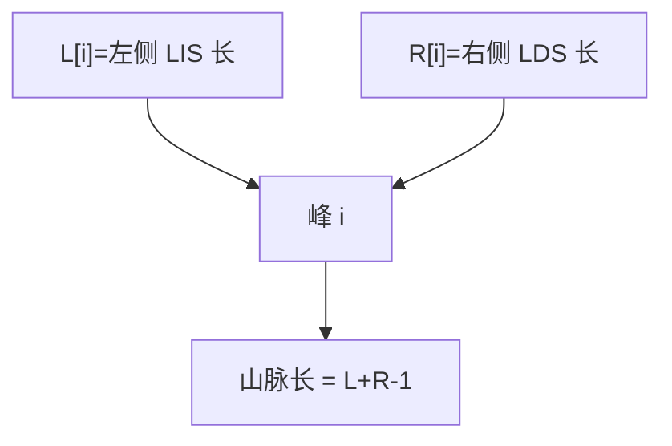

# LC 1671. Minimum Number of Removals to Make Mountain Array

> Hard · [LeetCode](https://leetcode.com/problems/minimum-number-of-removals-to-make-mountain-array/) · Tags: Array, Binary Search, DP, Greedy

## 题意

删除最少元素，使数组成为**山脉数组**（严格先增后减，峰不能在两端）。

## 最优思路

对每个峰候选 `i`，求左侧以 `nums[i]` 结尾的最长严格递增长度 `L[i]`，右侧最长严格递减 `R[i]`（等价于反转后 LIS）。若 `L,R≥2`，山脉长 `L+R-1`，答案 `n - max`。

用 `bisect_left` 维护 tails 得 \(O(n\log n)\) LIS 长度数组。

## 图解



```text
… 升升 峰 降降 …
      ↑ 只保留一条最长山脉
```

## 复杂度

| 项 | 值 |
|----|----|
| 时间 | \(O(n\log n)\) |
| 空间 | \(O(n)\) |

## 代码

见 `1671.minimum-number-of-removals-to-make-mountain-array.py`。
