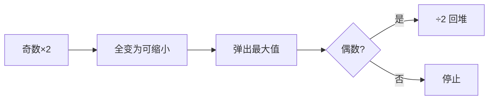

# LC 1675. Minimize Deviation in Array

> Hard · [LeetCode](https://leetcode.com/problems/minimize-deviation-in-array/) · Tags: Array, Greedy, Heap, Ordered Set

## 题意

对每个数：奇数可 `*2` 一次，偶数可 `/2` 任意次。最小化 `max - min`。

## 最优思路

奇数先全部 `*2`，使每个数只能再缩小（除 2）。用最大堆维护当前最大值，不断把偶数最大值减半，同时跟踪最小值；偏差取过程中最小值。最大值变奇数时无法再减，停止。

## 图解

## 复杂度

| 项 | 值 |
|----|----|
| 时间 | \(O(n\log n\log M)\) |
| 空间 | \(O(n)\) |

## 代码

见 `1675.minimize-deviation-in-array.py`。
