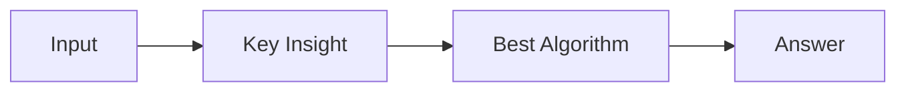

# LC 1687. Delivering Boxes from Storage to Ports

> Hard · [LeetCode](https://leetcode.com/problems/delivering-boxes-from-storage-to-ports/) · Tags: Array, Dynamic Programming, Segment Tree, Queue, Heap (Priority Queue), Prefix Sum, Monotonic Queue

## 题意

（待补：一句话题意）

## 最优思路

（待补：最优解核心 intuition）

## 图解

## 复杂度

| 项 | 值 |
|----|----|
| 时间 | TBD |
| 空间 | TBD |

## 代码

见同目录 `1687.delivering-boxes-from-storage-to-ports.py`。

## 参考

- https://leetcode.com/problems/delivering-boxes-from-storage-to-ports/
