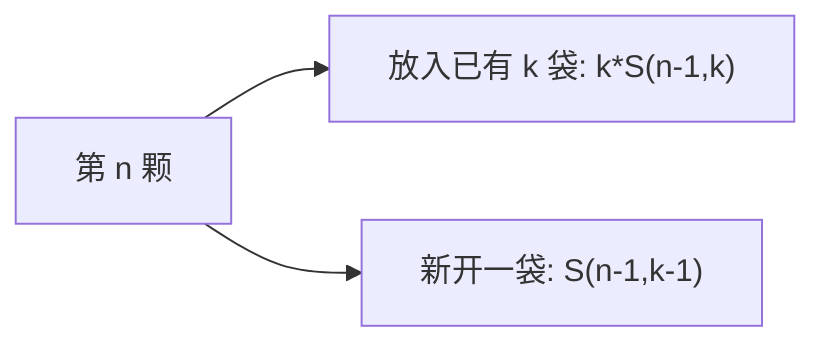

# LC 1692. Count Ways to Distribute Candies

> Hard · [LeetCode](https://leetcode.com/problems/count-ways-to-distribute-candies/) · Premium · Tags: DP

## 题意

把 n 颗不同糖果分到恰好 k 个非空袋子（袋内无序、袋间无序），求方案数 mod 1e9+7。

## 最优思路

第二类 Stirling 数：`S(n,k) = k*S(n-1,k) + S(n-1,k-1)`。

## 图解

## 复杂度

| 项 | 值 |
|----|----|
| 时间 | \(O(nk)\) |
| 空间 | \(O(nk)\) |

## 代码

见 `1692.count-ways-to-distribute-candies.py`。
