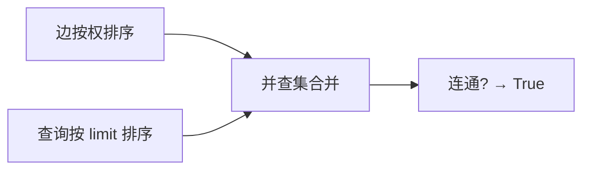

# LC 1697. Checking Existence of Edge Length Limited Paths

> Hard · [LeetCode](https://leetcode.com/problems/checking-existence-of-edge-length-limited-paths/) · Tags: Union-Find, Sorting, Graph

## 题意

无向带权图。对每个查询 `(p,q,limit)`：是否存在 `p` 到 `q` 的路径，且路径上每条边权都 **严格小于** `limit`。

## 最优思路

离线：边与查询都按权/limit 升序。对查询从小到大，把所有 `< limit` 的边并入并查集，再查连通性。

## 图解



```text
只并入 weight < limit 的边，等价于「严格小于」约束
```

## 复杂度

| 项 | 值 |
|----|----|
| 时间 | \(O(m\log m + q\log q + (n+m)\alpha(n))\) |
| 空间 | \(O(n+q)\) |

## 代码

见 `1697.checking-existence-of-edge-length-limited-paths.py`。
