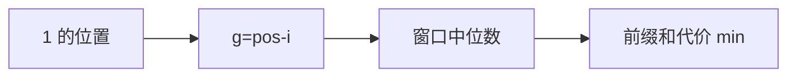

# LC 1703. Minimum Adjacent Swaps for K Consecutive Ones

> Hard · [LeetCode](https://leetcode.com/problems/minimum-adjacent-swaps-for-k-consecutive-ones/) · Tags: Array, Sliding Window, Prefix Sum, Median

## 题意

二进制数组，相邻交换。求使 `k` 个 `1` 变成连续所需最少交换次数。

## 最优思路

收集 `1` 的下标 `pos`。连续 `k` 个 `1` ≡ 把某窗口 `pos[i..i+k)` 聚到中位数。令 `g[i]=pos[i]-i` 消去间隔，用前缀和算到中位数的代价，取窗口最小。

## 图解

## 复杂度

| 项 | 值 |
|----|----|
| 时间 | \(O(n)\) |
| 空间 | \(O(n)\) |

## 代码

见 `1703.minimum-adjacent-swaps-for-k-consecutive-ones.py`。
