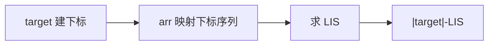

# LC 1713. Minimum Operations to Make a Subsequence

> Hard · [LeetCode](https://leetcode.com/problems/minimum-operations-to-make-a-subsequence/) · Tags: Hash Table, Binary Search, LIS

## 题意

`target` 互异。每次可在 `arr` 任意位置插入一个数。最少插入多少次，使 `target` 成为 `arr` 的子序列。

## 最优思路

`target` 中已在 `arr` 出现且相对顺序正确的最长子序列长度 = LIS。把 `arr` 中属于 `target` 的值映射为下标序列，求 LIS 长 `L`，答案 `|target|-L`。

## 图解

## 复杂度

| 项 | 值 |
|----|----|
| 时间 | \(O(n\log n)\) |
| 空间 | \(O(n)\) |

## 代码

见 `1713.minimum-operations-to-make-a-subsequence.py`。
