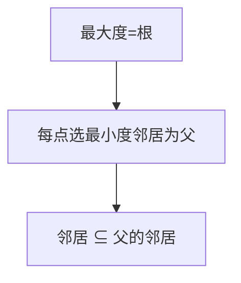

# LC 1719. Number of Ways to Reconstruct a Tree

> Hard · [LeetCode](https://leetcode.com/problems/number-of-ways-to-reconstruct-a-tree/) · Tags: Graph, Tree

## 题意

`pairs` 表示祖先-后代（无向）。判断能构成多少棵有根树使关系恰好匹配：返回 0 / 1 / 2（≥2 种）。

## 最优思路

度数 = 与多少节点有祖先后代关系。根度数必须为 `n-1`。按度数降序处理；每个点父为邻居中度数最小者，且邻居集合 ⊆ 父邻居∪{父}。度数与父相同则可互换 → 2。

## 图解

## 复杂度

| 项 | 值 |
|----|----|
| 时间 | \(O(n^2)\) |
| 空间 | \(O(n^2)\) |

## 代码

见 `1719.number-of-ways-to-reconstruct-a-tree.py`。
