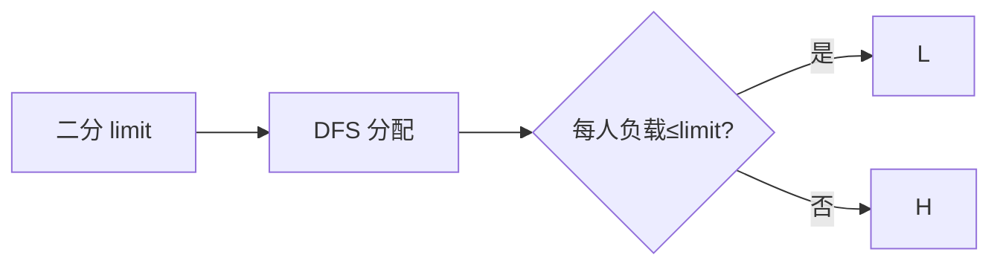

# LC 1723. Find Minimum Time to Finish All Jobs

> Hard · [LeetCode](https://leetcode.com/problems/find-minimum-time-to-finish-all-jobs/) · Tags: DP, Bitmask, Backtracking, Binary Search

## 题意

`n` 份工作耗时 `jobs[i]`，分给 `k` 个工人并行，每人串行做分配到的工作。最小化完成全部工作的时间（即最大工人负载）。

## 最优思路

二分答案 `limit`。可行性：工作降序 DFS 分配，剪枝——相同负载只试一次；空工人只填第一个（对称性）。

## 图解

## 复杂度

| 项 | 值 |
|----|----|
| 时间 | 剪枝后可过约束；理论指数 |
| 空间 | \(O(n+k)\) |

## 代码

见 `1723.find-minimum-time-to-finish-all-jobs.py`。
