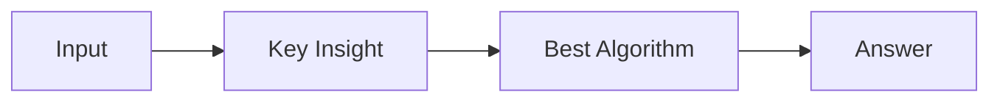

# LC 1724. Checking Existence of Edge Length Limited Paths II

> Hard · [LeetCode](https://leetcode.com/problems/checking-existence-of-edge-length-limited-paths-ii/) · Tags: Depth-First Search, Union-Find, Graph Theory, Design, Sorting, Heap (Priority Queue), Minimum Spanning Tree

## 题意

（待补：一句话题意）

## 最优思路

（待补：最优解核心 intuition）

## 图解

## 复杂度

| 项 | 值 |
|----|----|
| 时间 | TBD |
| 空间 | TBD |

## 代码

见同目录 `1724.checking-existence-of-edge-length-limited-paths-ii.py`。

## 参考

- https://leetcode.com/problems/checking-existence-of-edge-length-limited-paths-ii/
