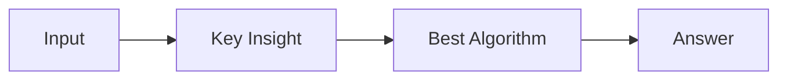

# LC 1735. Count Ways to Make Array With Product

> Hard · [LeetCode](https://leetcode.com/problems/count-ways-to-make-array-with-product/) · Tags: Array, Math, Dynamic Programming, Combinatorics, Number Theory, Prime Factorization, Fermat's Little Theorem

## 题意

（待补：一句话题意）

## 最优思路

（待补：最优解核心 intuition）

## 图解

## 复杂度

| 项 | 值 |
|----|----|
| 时间 | TBD |
| 空间 | TBD |

## 代码

见同目录 `1735.count-ways-to-make-array-with-product.py`。

## 参考

- https://leetcode.com/problems/count-ways-to-make-array-with-product/
