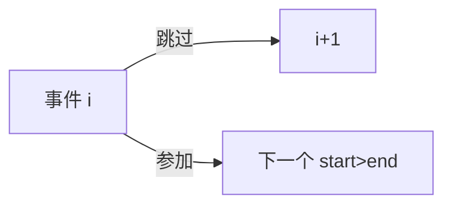

# LC 1751. Maximum Number of Events That Can Be Attended II

> Hard · [LeetCode](https://leetcode.com/problems/maximum-number-of-events-that-can-be-attended-ii/) · Tags: Array, Binary Search, DP

## 题意

每个会议 `[start, end, value]`，一天只能参加一个且完整参加。最多参加 `k` 个，求最大价值和。

## 最优思路

按 start 排序。`dfs(i,t)`：从第 `i` 个会议起还可选 `t` 个。跳过或选中；选中后 `bisect` 找第一个 `start > end` 的会议继续。记忆化。

## 图解

## 复杂度

| 项 | 值 |
|----|----|
| 时间 | \(O(nk\log n)\) |
| 空间 | \(O(nk)\) |

## 代码

见 `1751.maximum-number-of-events-that-can-be-attended-ii.py`。
