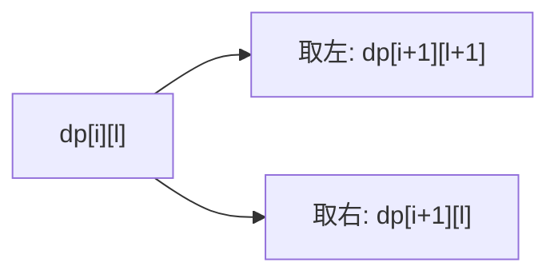

# LC 1770. Maximum Score from Performing Multiplication Operations

> Hard · [LeetCode](https://leetcode.com/problems/maximum-score-from-performing-multiplication-operations/) · Tags: Array, Dynamic Programming

## 题意

每次从 `nums` 两端取一个数，与下一个 `multipliers[i]` 相乘并加分；共做 `m = len(multipliers)` 次。求最大得分。

## 最优思路

状态 `dp[i][l]`：用完前 `i` 个 multiplier，左侧取了 `l` 个（右侧自然取了 `i-l` 个）。转移：下一次乘左端 `nums[l]` 或右端 `nums[n-1-(i-l)]`。答案 `max(dp[m])`。

## 图解

## 复杂度

| 项 | 值 |
|----|----|
| 时间 | \(O(m^2)\) |
| 空间 | \(O(m^2)\) |

## 代码

见 `1770.maximum-score-from-performing-multiplication-operations.py`。
