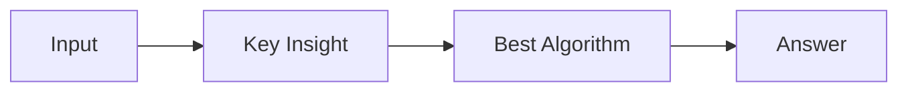

# LC 1782. Count Pairs Of Nodes

> Hard · [LeetCode](https://leetcode.com/problems/count-pairs-of-nodes/) · Tags: Array, Hash Table, Two Pointers, Binary Search, Graph Theory, Sorting, Counting

## 题意

（待补：一句话题意）

## 最优思路

（待补：最优解核心 intuition）

## 图解

## 复杂度

| 项 | 值 |
|----|----|
| 时间 | TBD |
| 空间 | TBD |

## 代码

见同目录 `1782.count-pairs-of-nodes.py`。

## 参考

- https://leetcode.com/problems/count-pairs-of-nodes/
