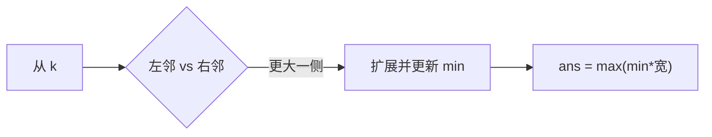

# LC 1793. Maximum Score of a Good Subarray

> Hard · [LeetCode](https://leetcode.com/problems/maximum-score-of-a-good-subarray/) · Tags: Array, Two Pointers, Binary Search, Stack, Monotonic Stack

## 题意

好子数组须包含下标 `k`，得分为 `min(subarray) * length`。求最大得分。

## 最优思路

从 `k` 双向扩展：每次优先向更大邻居一侧扩展，维护当前区间最小值，更新 `min * width`。贪心正确性：扩展时更大一侧能更久保持较大的 min。

## 图解

## 复杂度

| 项 | 值 |
|----|----|
| 时间 | \(O(n)\) |
| 空间 | \(O(1)\) |

## 代码

见 `1793.maximum-score-of-a-good-subarray.py`。
