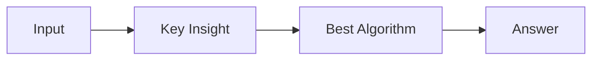

# LC 1793. Maximum Score of a Good Subarray

> Hard · [LeetCode](https://leetcode.com/problems/maximum-score-of-a-good-subarray/) · Tags: Array, Two Pointers, Binary Search, Stack, Monotonic Stack, Cartesian Tree

## 题意

（待补：一句话题意）

## 最优思路

（待补：最优解核心 intuition）

## 图解

## 复杂度

| 项 | 值 |
|----|----|
| 时间 | TBD |
| 空间 | TBD |

## 代码

见同目录 `1793.maximum-score-of-a-good-subarray.py`。

## 参考

- https://leetcode.com/problems/maximum-score-of-a-good-subarray/
