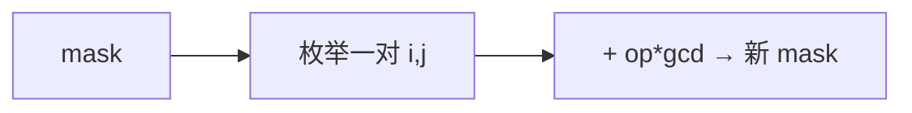

# LC 1799. Maximize Score After N Operations

> Hard · [LeetCode](https://leetcode.com/problems/maximize-score-after-n-operations/) · Tags: Array, Math, DP, Bitmask, GCD

## 题意

`2n` 个数，进行 `n` 次操作：第 `x` 次选两数得 `x * gcd`，求最大总分。

## 最优思路

状态为已用下标 bitmask。当前操作序号 = 已用个数/2+1。枚举一对未用下标转移，记忆化求最大。

## 图解

## 复杂度

| 项 | 值 |
|----|----|
| 时间 | \(O(2^{2n}\cdot n^2)\) |
| 空间 | \(O(2^{2n})\) |

## 代码

见 `1799.maximize-score-after-n-operations.py`。
