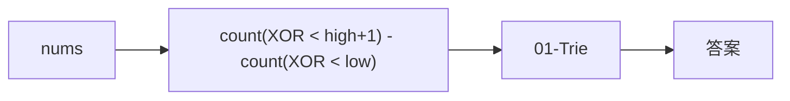

# LC 1803. Count Pairs With XOR in a Range

> Hard · [LeetCode](https://leetcode.com/problems/count-pairs-with-xor-in-a-range/) · Tags: Array, Bit Manipulation, Trie

## 题意

统计满足 `low ≤ nums[i] XOR nums[j] ≤ high`（`i < j`）的数对个数。

## 最优思路

区间计数转成「XOR `< high+1`」减「XOR `< low`」。用 01-Trie：先查询再插入；当 limit 当前位为 1 时，可把同比特整棵子树计入答案，再走异比特。

## 图解

## 复杂度

| 项 | 值 |
|----|----|
| 时间 | \(O(n \log A)\) |
| 空间 | \(O(n \log A)\) |

## 代码

见同目录 `1803.count-pairs-with-xor-in-a-range.py`。
