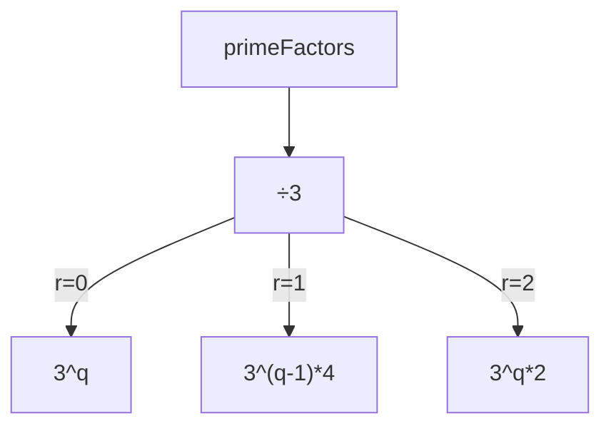

# LC 1808. Maximize Number of Nice Divisors

> Hard · [LeetCode](https://leetcode.com/problems/maximize-number-of-nice-divisors/) · Tags: Math, Recursion, Number Theory

## 题意

有 `primeFactors` 个质因子可分配成若干指数；nice 数的质因子指数之和等于该值，且 nice 除数个数为各指数乘积。求最大除数个数，模 \(10^9+7\)。

## 最优思路

等价「整数拆分最大化乘积」：尽量拆成 `3`；余 `1` 时改成两个 `2`（避免 `3+1`）；余 `2` 保留一个 `2`。用快速幂。

## 图解

## 复杂度

| 项 | 值 |
|----|----|
| 时间 | \(O(\log n)\) |
| 空间 | \(O(1)\) |

## 代码

见 `1808.maximize-number-of-nice-divisors.py`。
