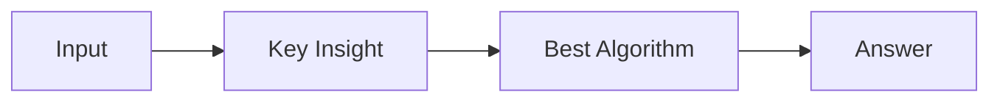

# LC 1825. Finding MK Average

> Hard · [LeetCode](https://leetcode.com/problems/finding-mk-average/) · Tags: Design, Queue, Heap (Priority Queue), Data Stream, Ordered Set, Treap

## 题意

（待补：一句话题意）

## 最优思路

（待补：最优解核心 intuition）

## 图解

## 复杂度

| 项 | 值 |
|----|----|
| 时间 | TBD |
| 空间 | TBD |

## 代码

见同目录 `1825.finding-mk-average.py`。

## 参考

- https://leetcode.com/problems/finding-mk-average/
