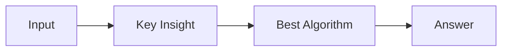

# LC 1830. Minimum Number of Operations to Make String Sorted

> Hard · [LeetCode](https://leetcode.com/problems/minimum-number-of-operations-to-make-string-sorted/) · Tags: Hash Table, Math, String, Combinatorics, Counting, Fermat's Little Theorem

## 题意

（待补：一句话题意）

## 最优思路

（待补：最优解核心 intuition）

## 图解

## 复杂度

| 项 | 值 |
|----|----|
| 时间 | TBD |
| 空间 | TBD |

## 代码

见同目录 `1830.minimum-number-of-operations-to-make-string-sorted.py`。

## 参考

- https://leetcode.com/problems/minimum-number-of-operations-to-make-string-sorted/
