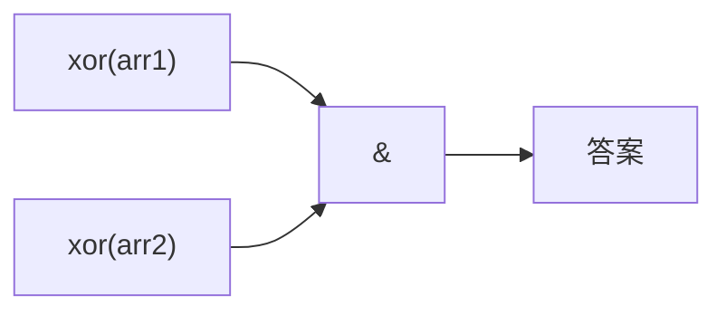

# LC 1835. Find XOR Sum of All Pairs Bitwise AND

> Hard · [LeetCode](https://leetcode.com/problems/find-xor-sum-of-all-pairs-bitwise-and/) · Tags: Array, Math, Bit Manipulation

## 题意

对所有对 `(i,j)` 计算 `arr1[i] & arr2[j]`，再全部异或，求结果。

## 最优思路

位运算分配律：\(\bigoplus_{i,j}(a_i\land b_j)=(\bigoplus a_i)\land(\bigoplus b_j)\)。直接对两数组分别异或再与。

## 图解

## 复杂度

| 项 | 值 |
|----|----|
| 时间 | \(O(n+m)\) |
| 空间 | \(O(1)\) |

## 代码

见 `1835.find-xor-sum-of-all-pairs-bitwise-and.py`。
