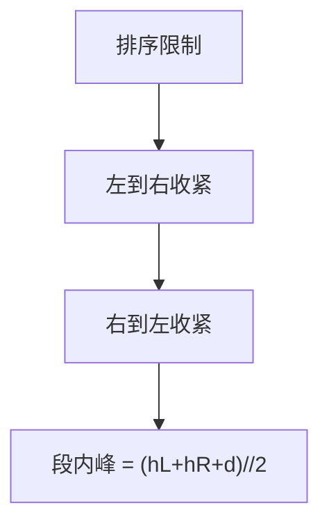

# LC 1840. Maximum Building Height

> Hard · [LeetCode](https://leetcode.com/problems/maximum-building-height/) · Tags: Array, Math, Sorting

## 题意

`n` 栋楼，相邻高度差至多 1，楼 1 高度为 0；若干 `(id, maxHeight)` 限制。求任意楼可达的最大高度。

## 最优思路

把 `(1,0)` 与 `(n,n-1)` 并入限制后排序。先左→右、再右→左用距离收紧高度上界。相邻两限制间峰值 `(hL+hR+dist)//2`，取全局最大。

## 图解

## 复杂度

| 项 | 值 |
|----|----|
| 时间 | \(O(r\log r)\) |
| 空间 | \(O(r)\) |

## 代码

见 `1840.maximum-building-height.py`。
