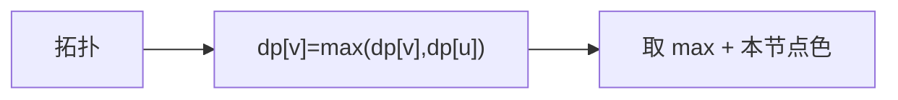

# LC 1857. Largest Color Value in a Directed Graph

> Hard · [LeetCode](https://leetcode.com/problems/largest-color-value-in-a-directed-graph/) · Tags: Graph, Topo, DP, Memoization

## 题意

有向图节点有颜色。一条路径的色值为路径上出现最多的颜色次数。求所有路径最大色值；有环返回 `-1`。

## 最优思路

拓扑排序 + `dp[u][c]`：到达 `u` 时颜色 `c` 的最大次数。无环则处理节点数 `< n`。

## 图解

## 复杂度

| 项 | 值 |
|----|----|
| 时间 | \(O(26(V+E))\) |
| 空间 | \(O(26V+E)\) |

## 代码

见 `1857.largest-color-value-in-a-directed-graph.py`。
