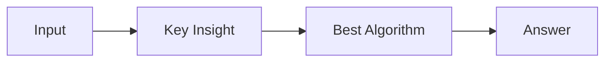

# LC 1896. Minimum Cost to Change the Final Value of Expression

> Hard · [LeetCode](https://leetcode.com/problems/minimum-cost-to-change-the-final-value-of-expression/) · Tags: Math, String, Dynamic Programming, Stack

## 题意

（待补：一句话题意）

## 最优思路

（待补：最优解核心 intuition）

## 图解

## 复杂度

| 项 | 值 |
|----|----|
| 时间 | TBD |
| 空间 | TBD |

## 代码

见同目录 `1896.minimum-cost-to-change-the-final-value-of-expression.py`。

## 参考

- https://leetcode.com/problems/minimum-cost-to-change-the-final-value-of-expression/
