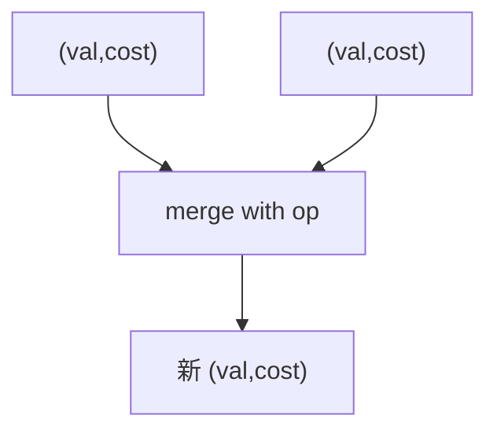

# LC 1896. Minimum Cost to Change the Final Value of Expression

> Hard · [LeetCode](https://leetcode.com/problems/minimum-cost-to-change-the-final-value-of-expression/) · Tags: Math, String, Dynamic Programming, Stack

## 题意

合法布尔表达式（`0/1/&/|/()`），可改数字或运算符。求使最终值翻转的最少操作次数。`&` `|` 同级左结合。

## 最优思路

每个子表达式维护 `(当前值, 翻转最小代价)`。叶子翻转代价 1；合并时按 `&`/`|` 四种真值表取改一边、两边或改运算符的最小代价。栈解析括号。

## 图解

## 复杂度

| 项 | 值 |
|----|----|
| 时间 | \(O(n)\) |
| 空间 | \(O(n)\) |

## 代码

见 `1896.minimum-cost-to-change-the-final-value-of-expression.py`。
