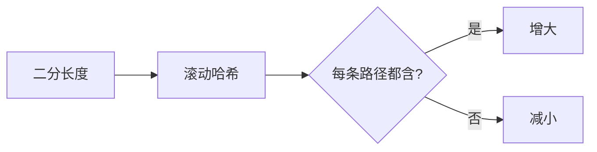

# LC 1923. Longest Common Subpath

> Hard · [LeetCode](https://leetcode.com/problems/longest-common-subpath/) · Tags: Array, Binary Search, Rolling Hash, Suffix Array, Hash Function, Suffix Automaton, Suffix Tree

## 题意

多条路径（城市序列）的最长公共子路径长度。

## 最优思路

对长度二分；滚动哈希统计每个长度为 mid 的子串出现在多少条路径中，全部出现则可行。

## 图解

## 复杂度

| 项 | 值 |
|----|----|
| 时间 | \(O(L\log L)\) |
| 空间 | \(O(L)\) |

## 代码

见 `1923.longest-common-subpath.py`。
