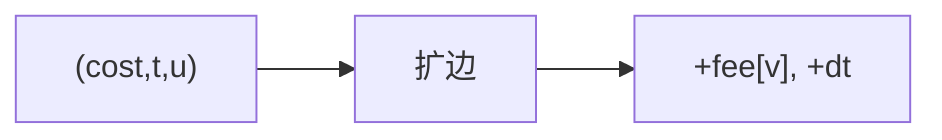

# LC 1928. Minimum Cost to Reach Destination in Time

> Hard · [LeetCode](https://leetcode.com/problems/minimum-cost-to-reach-destination-in-time/) · Tags: Graph, Shortest Path, DP

## 题意

无向图边有通行时间，节点有费用。从 0 到 n−1，总时间 ≤ `maxTime`，最小化费用和。

## 最优思路

费用优先 Dijkstra，状态 `(节点, 已用时间)`，`best[u][t]` 存最小费用。

## 图解

## 复杂度

| 项 | 值 |
|----|----|
| 时间 | \(O(nT\log(nT))\) |
| 空间 | \(O(nT)\) |

## 代码

见 `1928.minimum-cost-to-reach-destination-in-time.py`。
