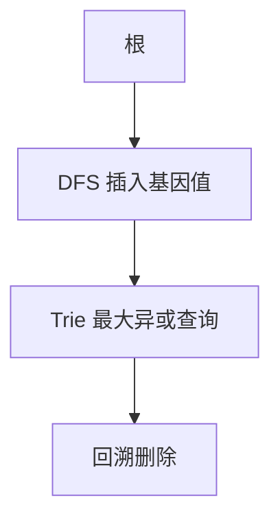

# LC 1938. Maximum Genetic Difference Query

> Hard · [LeetCode](https://leetcode.com/problems/maximum-genetic-difference-query/) · Tags: Array, Hash Table, Bit Manipulation, Depth-First Search, Trie

## 题意

有根树上，询问：从 `node` 到根路径上某点与 `val` 的最大异或。

## 最优思路

二进制字典树维护根到当前点路径。DFS 进入插入、离开删除；在该点回答挂起的询问。

## 图解

## 复杂度

| 项 | 值 |
|----|----|
| 时间 | \(O((n+q)\log V)\) |
| 空间 | \(O(n\log V)\) |

## 代码

见 `1938.maximum-genetic-difference-query.py`。
