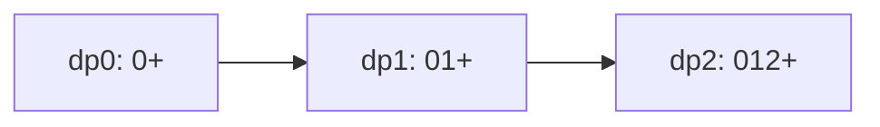

# LC 1955. Count Number of Special Subsequences

> Hard · [LeetCode](https://leetcode.com/problems/count-number-of-special-subsequences/) · Tags: Array, Dynamic Programming

## 题意

特殊子序列形如若干 `0` 后接若干 `1` 再接若干 `2`（每段至少一个）。求数组中这种子序列个数，模 \(10^9+7\)。

## 最优思路

三状态：`dp0/dp1/dp2` 分别统计已形成 `0+`、`0+1+`、`0+1+2+` 的子序列数。遇 `x`：`dpx = 2*dpx + dp_{x-1}`（翻倍含/不含当前，并从前态转移）。

## 图解

## 复杂度

| 项 | 值 |
|----|----|
| 时间 | \(O(n)\) |
| 空间 | \(O(1)\) |

## 代码

见 `1955.count-number-of-special-subsequences.py`。
