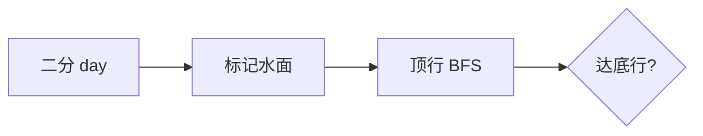

# LC 1970. Last Day Where You Can Still Cross

> Hard · [LeetCode](https://leetcode.com/problems/last-day-where-you-can-still-cross/) · Tags: Array, BFS, Union-Find, Binary Search, Matrix

## 题意

`row×col` 格子逐日按 `cells` 变水。求最晚一天仍能从顶行陆地走到底行（四连通）。

## 最优思路

对天数二分，前 `day` 个格子为水，BFS/DFS 检查顶→底是否可达。

## 图解

## 复杂度

| 项 | 值 |
|----|----|
| 时间 | \(O(rc\log(rc))\) |
| 空间 | \(O(rc)\) |

## 代码

见 `1970.last-day-where-you-can-still-cross.py`。
