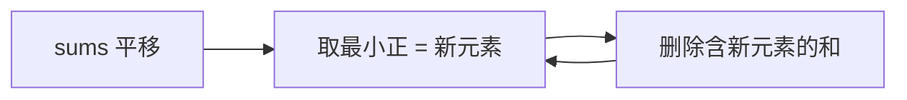

# LC 1982. Find Array Given Subset Sums

> Hard · [LeetCode](https://leetcode.com/problems/find-array-given-subset-sums/) · Tags: Array, Hash Table, Sorting, Counting

## 题意

给定数组全部子集和（无序），还原原数组（\(n\le 15\)）。

## 最优思路

平移使最小和为 0。有序多重集中最小正元素必为某元素；不断从含已还原元素的子集和中剥离开，得到下一个元素；最后符号翻转使平移量匹配。

## 图解

## 复杂度

| 项 | 值 |
|----|----|
| 时间 | \(O(2^n n)\) |
| 空间 | \(O(2^n)\) |

## 代码

见 `1982.find-array-given-subset-sums.py`。
