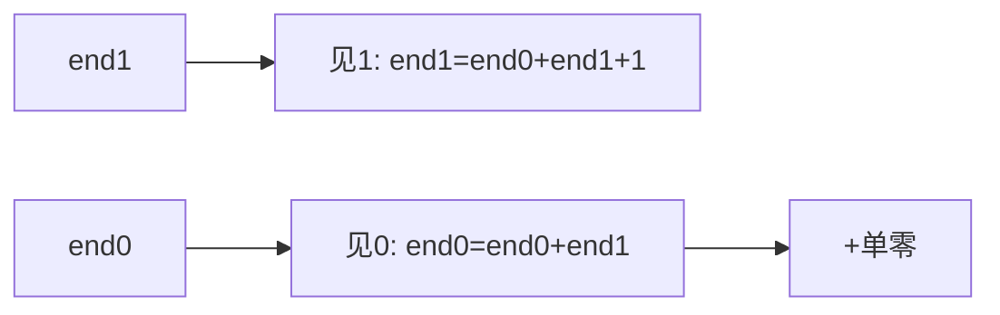

# LC 1987. Number of Unique Good Subsequences

> Hard · [LeetCode](https://leetcode.com/problems/number-of-unique-good-subsequences/) · Tags: String, Dynamic Programming

## 题意

二进制串中，无前导零的子序列（单独 `"0"` 允许）有多少个**不同**值，模 \(10^9+7\)。

## 最优思路

维护以 `0`/`1` 结尾的不同好子序列数 `end0/end1`：遇 `1` 则 `end1 = end0+end1+1`（可接在任意后或新开）；遇 `0` 则 `end0 = end0+end1`。若出现过 `0`，再加单独 `"0"`。

## 图解

## 复杂度

| 项 | 值 |
|----|----|
| 时间 | \(O(n)\) |
| 空间 | \(O(1)\) |

## 代码

见 `1987.number-of-unique-good-subsequences.py`。
