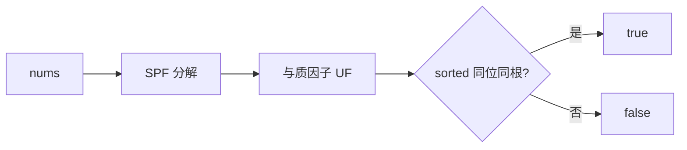

# LC 1998. GCD Sort of an Array

> Hard · [LeetCode](https://leetcode.com/problems/gcd-sort-of-an-array/) · Tags: Array, Math, Union-Find, Sorting, Number Theory, Prime Factorization

## 题意

仅当 `gcd(nums[i], nums[j]) > 1` 时可交换两数。判断能否通过交换把数组排成非降序。

## 最优思路

交换关系可传递：共享质因子的数在同一连通分量内可任意重排。筛最小质因子 SPF，把每个数与其质因子并查集合并；再对 `nums` 与 `sorted(nums)` 逐位检查是否同分量。

## 图解

## 复杂度

| 项 | 值 |
|----|----|
| 时间 | \(O(n\log A + A\log\log A)\) |
| 空间 | \(O(A)\) |

## 代码

见 `1998.gcd-sort-of-an-array.py`。
