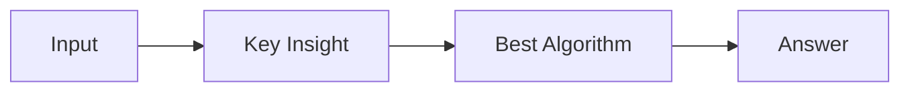

# LC 2014. Longest Subsequence Repeated k Times

> Hard · [LeetCode](https://leetcode.com/problems/longest-subsequence-repeated-k-times/) · Tags: Hash Table, Two Pointers, String, Backtracking, Counting, Enumeration

## 题意

（待补：一句话题意）

## 最优思路

（待补：最优解核心 intuition）

## 图解

## 复杂度

| 项 | 值 |
|----|----|
| 时间 | TBD |
| 空间 | TBD |

## 代码

见同目录 `2014.longest-subsequence-repeated-k-times.py`。

## 参考

- https://leetcode.com/problems/longest-subsequence-repeated-k-times/
