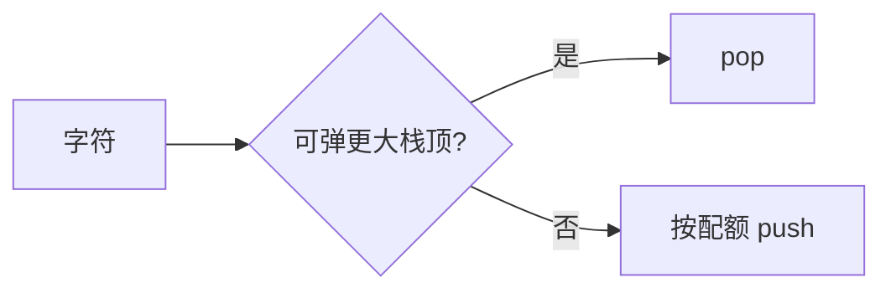

# LC 2030. Smallest K-Length Subsequence With Occurrences of a Letter

> Hard · [LeetCode](https://leetcode.com/problems/smallest-k-length-subsequence-with-occurrences-of-a-letter/) · Tags: String, Stack, Greedy, Monotonic Stack

## 题意

求长为 `k` 的字典序最小子序列，且字符 `letter` 至少出现 `repetition` 次。

## 最优思路

单调栈贪心：可弹栈当剩余字符仍能凑满 `k`，且弹出 `letter` 后剩余 `letter` 仍够 `repetition`。非 `letter` 仅在「空位 > 尚缺 letter 数」时入栈。

## 图解

## 复杂度

| 项 | 值 |
|----|----|
| 时间 | \(O(n)\) |
| 空间 | \(O(k)\) |

## 代码

见 `2030.smallest-k-length-subsequence-with-occurrences-of-a-letter.py`。
