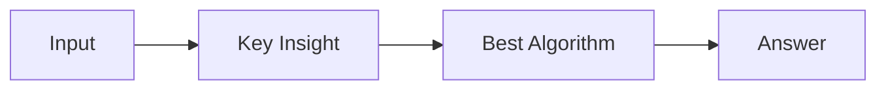

# LC 2030. Smallest K-Length Subsequence With Occurrences of a Letter

> Hard · [LeetCode](https://leetcode.com/problems/smallest-k-length-subsequence-with-occurrences-of-a-letter/) · Tags: String, Stack, Greedy, Monotonic Stack

## 题意

（待补：一句话题意）

## 最优思路

（待补：最优解核心 intuition）

## 图解

## 复杂度

| 项 | 值 |
|----|----|
| 时间 | TBD |
| 空间 | TBD |

## 代码

见同目录 `2030.smallest-k-length-subsequence-with-occurrences-of-a-letter.py`。

## 参考

- https://leetcode.com/problems/smallest-k-length-subsequence-with-occurrences-of-a-letter/
