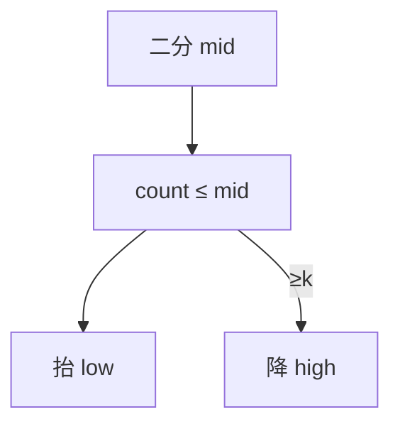

# LC 2040. Kth Smallest Product of Two Sorted Arrays

> Hard · [LeetCode](https://leetcode.com/problems/kth-smallest-product-of-two-sorted-arrays/) · Tags: Array, Binary Search, Two Pointers

## 题意

两有序数组，求所有 `nums1[i]*nums2[j]` 中第 `k` 小的乘积（1-indexed）。

## 最优思路

对乘积值二分。对每个 `a∈nums1`，在 `nums2` 上二分/双指针统计 `a*b ≤ mid` 的个数（注意 `a` 正/负/零）。

## 图解

## 复杂度

| 项 | 值 |
|----|----|
| 时间 | \(O(n\log m\log R)\) |
| 空间 | \(O(1)\) |

## 代码

见 `2040.kth-smallest-product-of-two-sorted-arrays.py`。
