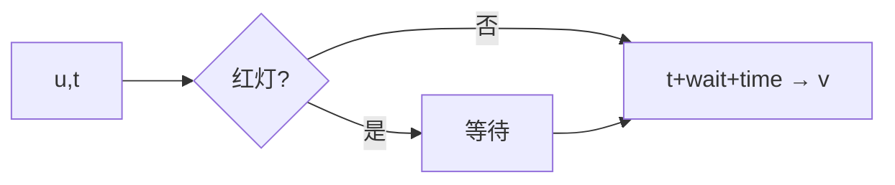

# LC 2045. Second Minimum Time to Reach Destination

> Hard · [LeetCode](https://leetcode.com/problems/second-minimum-time-to-reach-destination/) · Tags: BFS, Graph, Shortest Path

## 题意

无向图边权均为 `time`。红绿灯周期 `change`：`[0,change)` 绿，`[change,2change)` 红… 红灯需等。求从 1 到 n 的**严格第二小**到达时间。

## 最优思路

BFS 记录每个点第一次、第二次不同到达时间；转移时按当前时刻算等待。答案为 `dist[n][1]`。

## 图解

## 复杂度

| 项 | 值 |
|----|----|
| 时间 | \(O(n+m)\) |
| 空间 | \(O(n+m)\) |

## 代码

见 `2045.second-minimum-time-to-reach-destination.py`。
