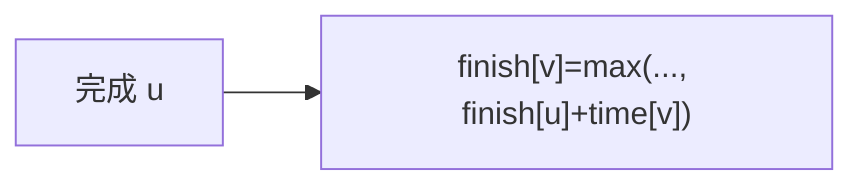

# LC 2050. Parallel Courses III

> Hard · [LeetCode](https://leetcode.com/problems/parallel-courses-iii/) · Tags: Graph, Topo, DP, Array

## 题意

`n` 门课有先修关系与学时 `time[i]`。可同时修多门（无冲突时）。求修完全部课程的最短月数。

## 最优思路

拓扑序 DP：`finish[v] = max(finish[v], finish[u] + time[v])`，答案 `max(finish)`。

## 图解

## 复杂度

| 项 | 值 |
|----|----|
| 时间 | \(O(n+m)\) |
| 空间 | \(O(n+m)\) |

## 代码

见 `2050.parallel-courses-iii.py`。
