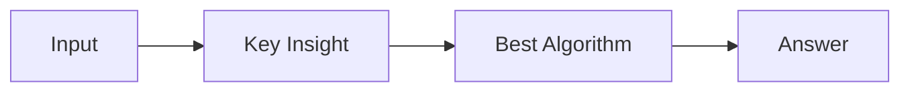

# LC 2060. Check if an Original String Exists Given Two Encoded Strings

> Hard · [LeetCode](https://leetcode.com/problems/check-if-an-original-string-exists-given-two-encoded-strings/) · Tags: String, Dynamic Programming

## 题意

（待补：一句话题意）

## 最优思路

（待补：最优解核心 intuition）

## 图解

## 复杂度

| 项 | 值 |
|----|----|
| 时间 | TBD |
| 空间 | TBD |

## 代码

见同目录 `2060.check-if-an-original-string-exists-given-two-encoded-strings.py`。

## 参考

- https://leetcode.com/problems/check-if-an-original-string-exists-given-two-encoded-strings/
